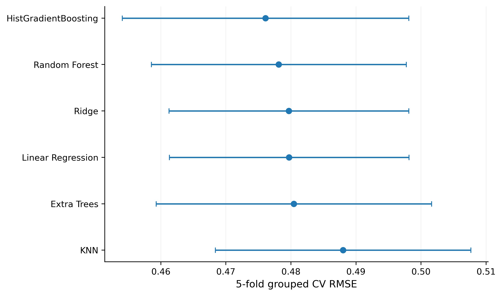
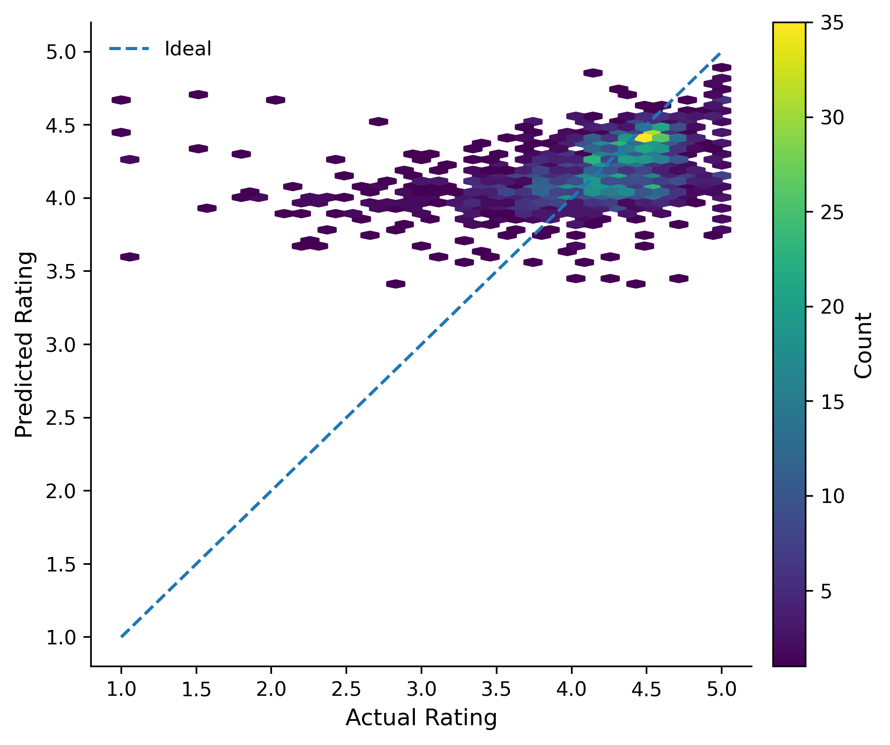

# Beyond Raw Ratings: Interpreting Google Play App Performance

**Group 22 · CA6002 — AI UX & Data Visualisation Design Principles**

This repository presents a collaborative group assignment investigating how Google Play Store metadata can explain application ratings. We follow a visually guided analytical workflow covering dataset exploration and preprocessing, regression model benchmarking, random forest hyperparameter tuning, learning curve diagnosis, and prediction error analysis.

Visualisations—including error bar charts and hyperparameter comparison tiles in the presentation—support model selection and the interpretation of model complexity and generalisation. Their design draws on visual perception and Gestalt principles to communicate patterns and trade-offs clearly. Our findings suggest that public store metadata has limited explanatory power for app ratings. This work demonstrates how visualisation supports interpretable regression modelling and communicates its limitations alongside predictive performance.

**This assignment was completed collaboratively by Group 22. The materials represent the group's collective work.** See [group attribution](group22-google-play-analysis/docs/GROUP_ATTRIBUTION.md) for presentation section responsibilities.

## Source acknowledgement

This Group 22 assignment draws on and adapts content from **data13's** Kaggle notebook [Machine Learning Model to Predict App Rating (94%)](https://www.kaggle.com/code/data13/machine-learning-model-to-predict-app-rating-94).

We acknowledge this reference for the assignment's analysis and modelling approach. Credit for borrowed content belongs to the original author. Group 22's contribution is the collaborative assignment presented here; we do not claim original authorship of all underlying methods or code.

The exact extent of reuse has not been mapped to individual code cells, passages or figures. The **94%** in the source notebook's title is not a performance claim for this project. The results reported below are from the supplied Group 22 v5 experiment tables.

## Start here

- [Group presentation](group22-google-play-analysis/presentation/group22_assignment.pptx): original 19-slide deck, preserved unchanged.
- [Exploration notebook](group22-google-play-analysis/notebooks/google_play_eda.ipynb): supplied EDA and preprocessing notebook, with outputs cleared and initialization order corrected.
- [Review notes](group22-google-play-analysis/docs/REVIEW_NOTES.md): known presentation inaccuracies and differences between source versions.
- [Source manifest](group22-google-play-analysis/docs/source_manifest.csv): original paths and SHA-256 hashes of retained archive artifacts.

## Research questions

1. How are ratings distributed across app types and categories?
2. How much predictive information is available in public metadata?
3. Where does the model fail, and how should ratings be interpreted alongside reviews and installs?

## Dataset and workflow

The supplied Google Play Store dataset contains **10,841 records and 13 variables**. The v5 results report one malformed row and 483 exact duplicate rows removed, leaving **10,357 cleaned records**.

Of these, **8,892 records have observed ratings** and are used for modelling. A separate dataset of **8,196 unique rated apps** supports app-level storytelling. These counts refer to different analytical units.

The analytical workflow covers:

- Conditioning reviews, installs, prices, sizes and dates.
- Exploring rating distributions and relationships across app groups.
- Examining log transforms for long-tailed variables.
- Comparing regression models using tables labelled as grouped cross-validation.
- Tuning random forest complexity and examining learning curves.
- Analysing prediction errors by rating, review and install bands.
- Interpreting ratings alongside evidence strength and market coverage.

The original model-training implementation was not included in the supplied files. Its exact split and fitting procedures have therefore not been independently audited.

## Main results

The following results are read from the supplied v5 tables, not from a new training run.

### Model benchmark

| Model | 5-fold grouped CV RMSE | RMSE standard deviation |
| --- | ---: | ---: |
| HistGradientBoosting | 0.4761 | 0.0220 |
| Random Forest | 0.4781 | 0.0196 |
| Ridge | 0.4797 | 0.0184 |
| Linear Regression | 0.4797 | 0.0184 |
| Extra Trees | 0.4804 | 0.0212 |
| KNN | 0.4880 | 0.0197 |

HistGradientBoosting has the lowest benchmark mean RMSE. The group selected Random Forest for further analysis, considering performance and the interpretation of model behaviour. The CV standard deviations describe fold variation; they are not confidence intervals.



### Final random forest evaluation

The CV-selected random forest uses **max_depth = 10** and **min_samples_leaf = 7**.

| Metric | Value |
| --- | ---: |
| MAE | 0.3317 |
| RMSE | 0.4946 |
| R² | 0.1558 |
| Training records | 7,094 |
| Test records | 1,798 |

Source: [final holdout metrics](group22-google-play-analysis/results/slide_tables/S11_final_rf_holdout_metrics.csv).

The separate `verified_holdout_model_comparison.csv` contains another Random Forest result. See the review notes before combining results from different experiments.



## Interpretation

The final model explains about **15.6% of the holdout variation** under this evaluation. Predictions concentrate near the middle of the rating distribution.

For apps rated at or below 3.5, the observed mean is approximately **2.99**, while the predicted mean is approximately **4.03**, with MAE around **1.04**. This indicates that the model struggles to identify genuinely low-rated apps.

Reviews and installs provide important predictive signals, but predictive importance does not establish causation. Low-review and low-install groups have larger prediction errors. Perfect five-star ratings are concentrated among apps with little review evidence in this dataset.

The group therefore recommends interpreting three signals together:

| Signal | Interpretation |
| --- | --- |
| Rating | User satisfaction |
| Reviews | Evidence supporting the rating |
| Installs | Market coverage |

## Repository layout

```text
README.md
group22-google-play-analysis/
├── data/
│   ├── raw/
│   └── processed/
├── notebooks/
├── results/
│   ├── slide_tables/
│   └── model_experiments/
├── figures/
├── presentation/
├── docs/
└── requirements.txt
```

## Run the exploration notebook

Use Python 3.10 or newer. From the repository root, enter the project directory:

```bash
cd group22-google-play-analysis
python -m venv .venv

# Windows PowerShell
.venv\Scripts\Activate.ps1

# macOS / Linux
# source .venv/bin/activate

python -m pip install -r requirements.txt
jupyter notebook notebooks/google_play_eda.ipynb
```

Run cells in order. The notebook reads `data/raw/googleplaystore.csv`; it also supports being launched from the project's `notebooks/` directory.

The notebook explores and conditions data but **does not regenerate the v5 model metrics or figures**. Its saved outputs were cleared, and execution has not been verified during repository preparation. Dependencies are not version-locked.

## Provenance and limitations

The supplied Group 22 v5 archive is the source for the included data, result tables and figures. The [source manifest](group22-google-play-analysis/docs/source_manifest.csv) records original archive paths and SHA-256 hashes of retained artifacts.

The PowerPoint was copied unchanged. Known numerical and wording issues are documented in the [review notes](group22-google-play-analysis/docs/REVIEW_NOTES.md). The internal presentation handoff DOCX is excluded.

This repository preserves the available assignment materials. It does not yet provide a complete, independently verified reproduction of the modelling workflow.

The Kaggle notebook acknowledgement identifies a reference used for the assignment. It does not establish the exact original dataset download source or its redistribution licence. Dataset sharing terms remain to be confirmed, and no software or dataset licence has been assigned to this repository.

The original presentation includes team names and university email addresses on its title slide.
